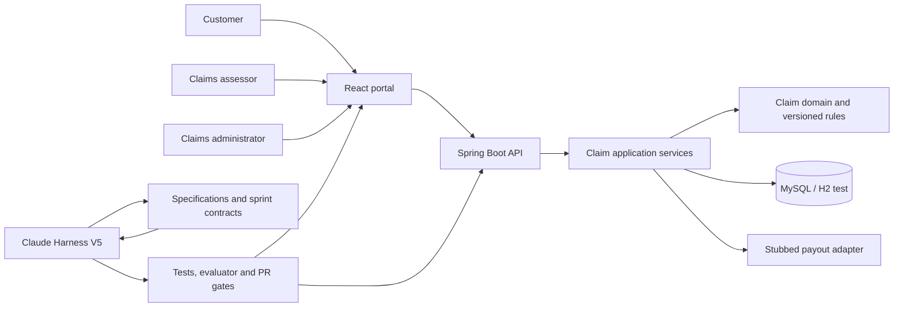
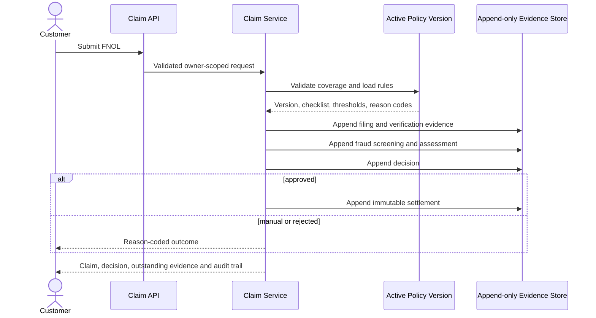

# ClaimFlow Architecture

## Layered Structure

- `api`: HTTP contracts, validation, controller authorization, and error mapping.
- `service`: transactional use cases and orchestration.
- `domain`: aggregates, policies, value rules, lifecycle, and domain exceptions.
- `repository`: persistence ports implemented by Spring Data.
- `resources/db/migration`: forward-only Flyway schema evolution.
- `frontend`: React customer, assessor, and administrator workspaces.
- `.claude`: locked Harness V5 foundation plus ClaimFlow-specific engineering controls.

Dependencies point inward: API depends on services; services depend on domain and repository ports; domain does not depend on API, service, repository, or configuration packages.

## Context Diagram

## FNOL-to-Settlement Sequence

## Persistence Strategy

The claim aggregate is the current-state projection. Filing, document verification, fraud screening, assessment, decision, transition, override, audit, and settlement evidence are stored as append-only records. Immutable evidence entities reject update and delete lifecycle callbacks. New persisted structures always arrive through a new Flyway migration.

## Security and Observability

Controller routes separate customer, assessor, and administrator responsibilities. Customers are additionally owner-scoped in the service layer. Request correlation IDs are generated or validated at the HTTP boundary, returned in `X-Correlation-ID`, and placed in structured logging context. Request bodies, narratives, credentials, and document content are never logged.

## Operations Projections

The administrator dashboard derives status and product counts from the claim projection, identifies deterministic fraud alerts, and totals immutable settlements. The UI exposes separate claim, fraud-alert, and payout-audit queues without duplicating or mutating the underlying evidence. Flyway V5 supplies one synthetic claim per product so the single-command demonstration opens with representative data.
